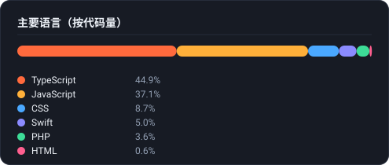

  
   
  
    

  
  
  
  

## 小鱼

独立开发。只做**装上就会天天用**的软件，不做演示页。

协议逆向、音视频管线、渲染进程沙箱、自建更新通道、服务器部署——一条链自己走完，不给"做不了"留位置。

> 会写，是及格线；能发版、能更新、能扛住线上，才算做完。

## 战绩

| **60+** | **134** | **170+** | **5** | **3** |
|:---:|:---:|:---:|:---:|:---:|
| 网易云接口 | IPC 通道 | 自动化测试 | 音源接入 | 更新通道 |
| weapi / eapi 双通道，限流自动降级 | 渲染进程零特权，全部走具名通道 | 含真实网络与真实 mpv 解码 | 网易云 / 汽水 / 酷狗 / 酷我 / QQ | 自建镜像 → GitHub → 官网，自动降级 |

## 现在在做

### 悠悠音乐 · Windows 桌面音乐客户端

**Electron 33 + React 18 + TypeScript，音频后端交给 mpv。** 自建悠悠账号（邮箱验证码登录，令牌两年有效，收藏 / 歌单 / 昵称 / 头像多设备实时同步），网易云与 QQ 退成「音源账号」按需绑定。在线播放、歌单 / 专辑 / 歌手、每日推荐、私人漫游、桌面歌词、全屏播放页、一起听、下载与转 MP3、搜索联想、播放变速。

几个我认为值得看的地方：

- **双通道传输**：weapi 被限流会返回 200 空体，同一请求自动改走 eapi——这不是兜底，是内建降级
- **完整音源补齐**：官方只给试听片段时，按「时长 ±5s / 歌名归一化相同 / 版本标记一致 / 歌手命中」四条全中才换源，**宁可跳过，也不播半截、不播翻唱**
- **音质不虚报**：达不到所选档位就逐档降，并按 mpv 报出的**真实码率**显示，换源时也不会虚标成「母带」
- **播放失败绝不跳歌**：原地换音源 / 换档位 / 换 CDN 主机重试，队列和界面都不动
- **一起听自带服务端**：零依赖 Node 中继，TLS + 连接口令、播放同步、聊天、礼物、支付宝当面付充值
- **内置更新**：便携版自替换、安装版静默安装，更新后自动重开

### 优淘 · 解锁商店后台

原生 iOS 后台管理端：SwiftUI 写界面，服务端在云端编译未签名 IPA 再下发安装。一个人把管理端从界面做到分发链路。

### 微信黑名单管理系统

移动端优先的黑名单管理平台：模块分类、图片与视频上传、多用户权限隔离。给真实运营用的后台，不是课程作业。

## 技术栈

**桌面 / 客户端**

**服务端 / 运维**

**工程**

## 数据

  
  

  

## 联系

- 悠悠音乐官网：<https://yy.ytw.asia>
- 悠悠音乐源码与发布：<https://github.com/1191533749/youyou-music>
- 微信公众号：

  Think it · Build it · Ship it

