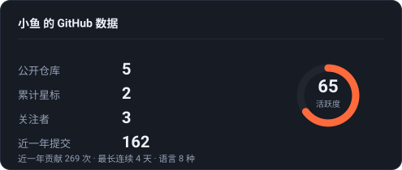

  
   
  
    

  
  
  
  

## 关于

小鱼，甘肃。独立开发，主要写 Windows 桌面端和 Node 服务端，也写过 PHP 和 Swift。

目前在维护悠悠音乐，一个 Windows 上的音乐客户端。

## 悠悠音乐

Electron 33 + React + TypeScript，播放交给 mpv。账号是自己做的：邮箱验证码登录，收藏、歌单、昵称、头像多设备同步，网易云和 QQ 只当音源账号按需绑定。

播放器、歌单、专辑、歌手、每日推荐、私人漫游、桌面歌词、全屏播放页、一起听、下载、搜索联想、倍速，都在里面。当前版本 v0.6.0。

当初花时间比较多的几处：

- weapi 被限流时会返回 200 空体，所以同一个请求会改走 eapi
- 官方只给试听片段时，换源要求时长 ±5 秒、歌名归一化后相同、版本标记一致、歌手命中，四条都对了才换，不对就跳过，不播半截
- 音质按 mpv 报出来的真实码率显示，不按请求的档位显示
- 播放失败不跳下一首，原地换音源、换档位、换 CDN 主机重试
- 「一起听」的服务端也在仓库里，server 目录，零依赖 Node，带 TLS、连接口令和支付宝当面付
- 更新从自建镜像、GitHub、官网依次降级，便携版自替换

## 另外两个

**[优淘](https://github.com/1191533749/YoutaoAdmin)** —— 优淘解锁商店的 iOS 后台管理端，SwiftUI 写的。服务端在云端把 IPA 编译成未签名包再下发安装。

**[微信黑名单管理系统](https://github.com/1191533749/-)** —— PHP，移动端优先。模块分类、图片视频上传、多用户权限隔离，给实际运营在用。

## 技术栈

TypeScript · Electron · React · mpv · SwiftUI · Node.js · PHP · Python · nginx · MySQL · SQLite · Linux · GitHub Actions

## 数据

  
  

  

## 联系

- 官网：<https://yy.ytw.asia>
- 源码与发布：<https://github.com/1191533749/youyou-music>
- 微信公众号：

