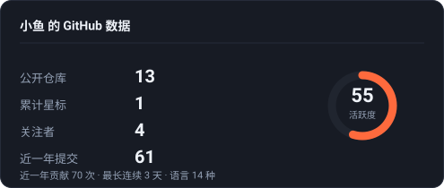
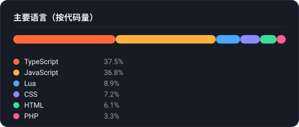

  
   
  

  
  
  
  

## 关于我

独立开发，**全栈**。做 Windows 桌面客户端、Web 前端与 Node 服务端，喜欢把接口、音视频和系统层的东西一直做到能用、好用。
不写演示项目——写的是装上就会天天用的软件。

- 现在在做：**[悠悠音乐](https://github.com/1191533749/youyou-music)** —— 一个 Electron + mpv 的 Windows 桌面音乐客户端，扫码登录、每日推荐、桌面歌词、全屏播放页、一起听，带内置更新，已经迭代到 **v0.4.2**
- 顺手在写：自建公网中继服务（零依赖 Node）、静态官网、各种自动化脚本
- 常驻地：甘肃 · [剑指网络](https://ytw.asia)

## 技术栈

## 数据

  
  

  

  上面三张图是仓库里自己画的 SVG，由 GitHub Actions 每天刷新（<a href="scripts/render-cards.mjs">scripts/render-cards.mjs</a>），不依赖任何第三方图床，所以在哪都能打开。

## 精选作品

### 悠悠音乐 · Windows 桌面音乐客户端

Electron + React + TypeScript 写的 Windows 客户端，音频后端用 **mpv**，账号体系对接网易云（扫码登录）。
在线播放、歌单/专辑/歌手、每日推荐、私人漫游、云盘、桌面歌词、全屏播放页、一起听，一套都在。

几处我认为值得看的地方：

- **weapi / eapi 双通道**：报文格式与线上一致，有限流自动降级（weapi 返回空体时自动改走 eapi）
- **完整音源自动补齐**：拿不到完整音频时按「时长 ±5 秒 / 歌名归一化相同 / 版本标记一致 / 歌手命中」四条全中才换源，宁可跳过也不播半截、不播翻唱
- **音质不虚报**：达不到所选档位就降档，并按 mpv 报出的**真实码率**显示实际档位
- **播放失败绝不跳歌**：原地换音源 / 换档位 / 换 CDN 主机重试
- **内置更新**：启动检测 Release，便携版自替换、安装版静默安装；更新失败兜底打开官网

 

### 微信黑名单管理系统

移动端优先的管理后台：模块分类、图片与视频上传、多用户与权限控制，PHP 实现，跑在自己的服务器上。

### 一起听 · 公网中继

悠悠音乐「一起听」的自建服务端：零依赖 Node（只用标准库），TLS + 连接口令、播放同步、聊天与礼物、支付宝当面付充值。
用 systemd 常驻，源码在 [youyou-music/server](https://github.com/1191533749/youyou-music/tree/master/server)。

## 联系

- 官网：<https://ytw.asia> · 悠悠音乐：<https://yy.ytw.asia>
- 微信公众号（悠悠音乐更新与下载）：

  Think it · Build it · Ship it

